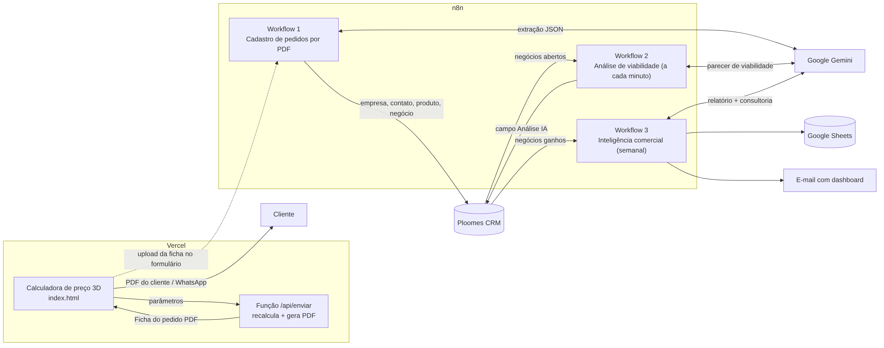
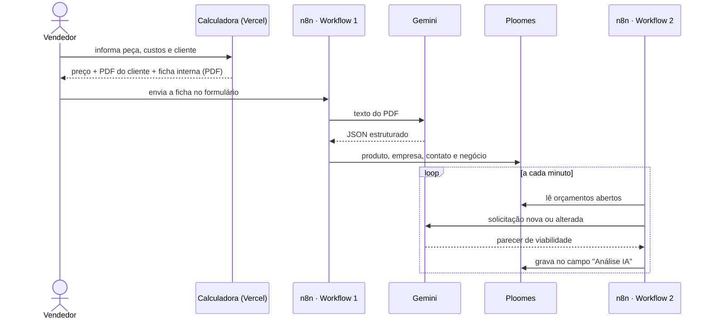

# Red Geek AI — Automação de CRM com Inteligência Artificial

> Precificação, cadastro inteligente de pedidos e análise de viabilidade para uma empresa de impressão 3D, integrando **calculadora web (Vercel)**, **n8n**, **Google Gemini** e **Ploomes CRM**.

Projeto aplicado a um caso empresarial real, a **Red Geek 3D Studio**. Todos os dados deste repositório são **fictícios** ou foram **substituídos por marcadores**. Não há credenciais, dados de clientes nem números de vendas.



---

## O problema

Em uma operação de impressão 3D, cada orçamento depende de muitas variáveis: filamento, hora-máquina, energia, falhas, mão de obra, embalagem, taxas de marketplace e margem. Antes do projeto, esse cálculo era manual. Os pedidos eram digitados no CRM campo a campo, e a decisão de aceitar ou não um pedido dependia de intuição.

## A solução

| Etapa | Componente | O que faz |
|---|---|---|
| 1. Precificar | **Calculadora de preço 3D** (Vercel) | Calcula o preço em tempo real e gera dois PDFs: o orçamento do cliente (enviado pelo WhatsApp) e a ficha interna do pedido, com a composição completa dos custos |
| 2. Cadastrar | **Workflow 1** — Cadastro de pedidos por PDF (n8n) | Recebe a ficha em PDF, extrai os dados com o Gemini, valida, busca ou cria o produto, a empresa e o contato, e cria o negócio no Ploomes com os campos comerciais e de produção |
| 3. Analisar | **Workflow 2** — Análise de viabilidade com IA (n8n) | Monitora os orçamentos abertos e gera um parecer em 10 seções (financeiro, produção, prazos e riscos), gravado no próprio negócio |
| 4. Gerir | **Workflow 3** — Inteligência comercial (n8n) | Toda semana consolida as vendas ganhas por mês, canal e produto, projeta o faturamento, gera relatório e consultoria com IA, alimenta o Google Sheets e envia um dashboard por e-mail |



## Estrutura do repositório

```text
tcc-ai-crm-automation/
├── calculadora/            Web app de precificação (Vercel)
│   ├── index.html          interface e cálculo em tempo real
│   └── api/                função serverless: recálculo e ficha em PDF
├── workflows/              exports sanitizados do n8n (importáveis)
├── docs/                   arquitetura, integrações, regras e segurança
├── examples/               ficha PDF, JSON e payloads 100% fictícios
├── tests/                  cenários de validação e status real dos testes
├── scripts/                limpeza de exports e varredura de segredos
└── assets/                 diagrama e captura de tela
```

## Documentação

| Documento | Conteúdo |
|---|---|
| [Arquitetura](docs/arquitetura.md) | Componentes, fluxo de dados e responsabilidade de cada nó |
| [Calculadora](docs/calculadora.md) | Fórmula de precificação, PDFs e função serverless |
| [Integração Ploomes](docs/integracao-ploomes.md) | Endpoints, autenticação e payloads |
| [Integração Gemini](docs/integracao-gemini.md) | Prompts, contratos de saída e regras de qualidade |
| [Regras de negócio](docs/regras-de-negocio.md) | Valor líquido, lucro, margem e canais |
| [Mapeamento de campos](docs/mapeamento-campos.md) | Campos personalizados e marcadores a configurar |
| [Instalação](docs/instalacao.md) | Como implantar a calculadora e importar os workflows |
| [Segurança](docs/seguranca.md) | O que foi removido e como manter o repositório limpo |
| [Análise técnica](docs/analise-tecnica.md) | Implementação comparada à especificação, achados e riscos |
| [Cenários de teste](tests/cenarios-de-validacao.md) | O que foi testado e o que está pendente |

## Status

| Funcionalidade | Situação |
|---|---|
| Calculadora com cálculo em tempo real, PDF do cliente e WhatsApp | Em produção |
| Ficha interna em PDF gerada no servidor | Em produção |
| Extração do PDF com Gemini e validação inicial | Implementado e testado |
| Busca e criação da opção de produto | Implementado; caminho "produto novo" pendente de teste isolado |
| Cadastro de empresa e responsável **novos** + criação do negócio | Testado |
| Empresa ou contato **já existentes** | Segunda fase (o fluxo hoje encerra nesse caso) |
| Ramo de pessoa física | Corrigido na v2; validado com dados fictícios, pendente de teste no Ploomes |
| Análise de viabilidade com IA e gravação no Ploomes | Implementado e testado |
| Bloqueio de reanálise sem alteração | Pendente de teste de repetição |
| Inteligência comercial semanal (Sheets + dashboard por e-mail) | Implementado; integração com os novos campos de produção é evolução futura |

## Tecnologias

`JavaScript` · `HTML/CSS` · `Node.js (Vercel Functions)` · `jsPDF` · `n8n` · `Google Gemini` · `Ploomes CRM (REST/OData)` · `Google Sheets` · `Gmail`

## Competências demonstradas

Arquitetura de integração · automação de processos · APIs REST e OData · IA aplicada a negócios (extração estruturada e análise crítica) · engenharia de dados · CRM · análise de viabilidade financeira e operacional · segurança de dados.

## Autor

**Patrick Duarte** — Red Geek 3D Studio
Projeto acadêmico (TCC), publicado para avaliação. O código e as regras de negócio pertencem ao autor. Veja [LICENSE](LICENSE).
