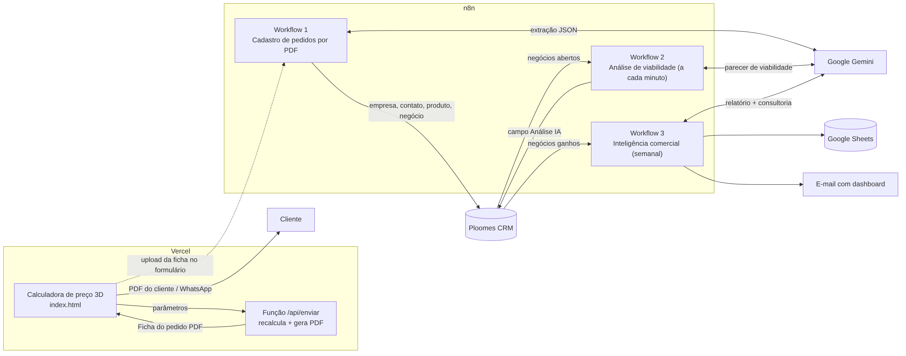
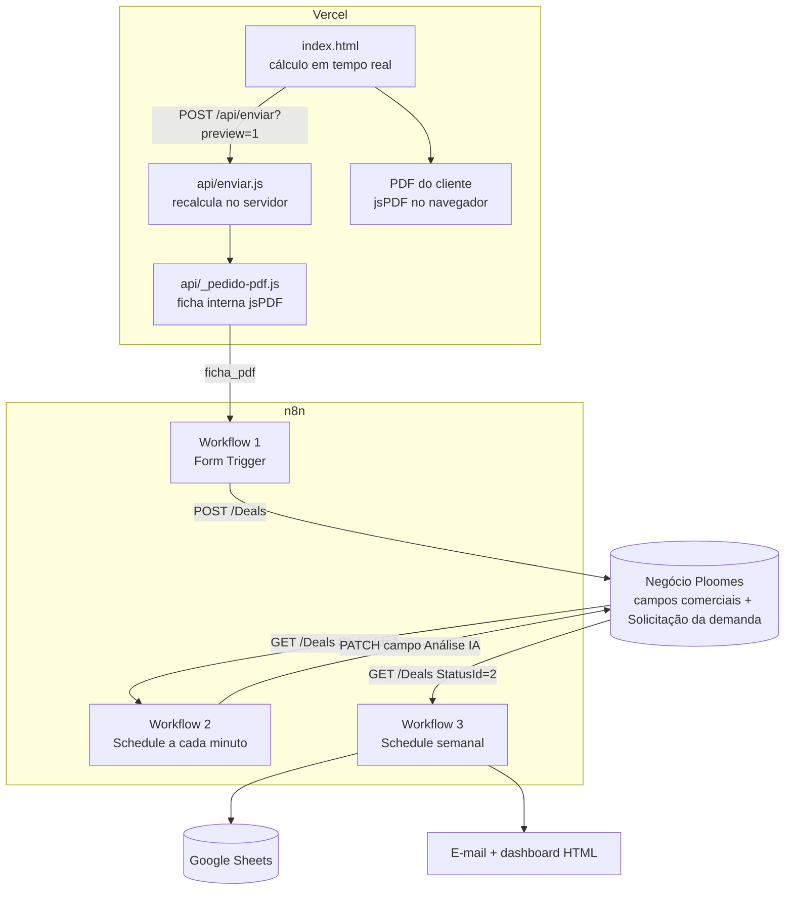
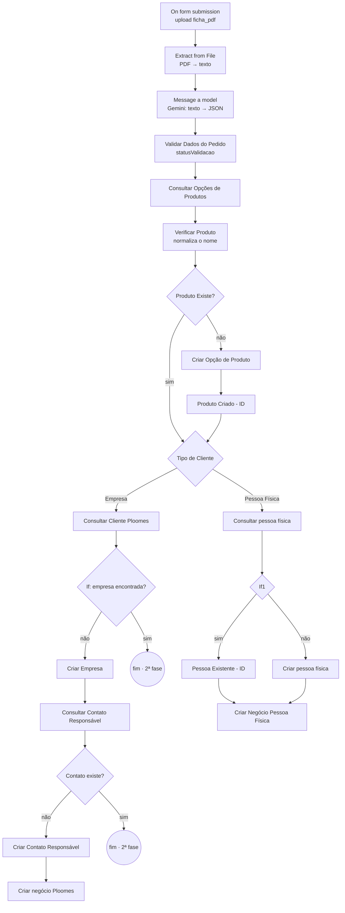
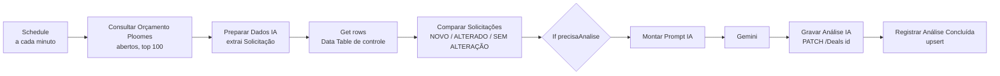

# Arquitetura

O projeto tem quatro componentes independentes, ligados por dois "contratos": a **ficha do pedido em PDF** (entre a calculadora e o Workflow 1) e os **campos personalizados do negócio no Ploomes** (entre os três workflows).

## 1. Calculadora (Vercel)

| Arquivo | Responsabilidade |
|---|---|
| `calculadora/index.html` | Interface, cálculo em tempo real, PDF do cliente (jsPDF no navegador) e compartilhamento no WhatsApp |
| `calculadora/api/enviar.js` | Função serverless: valida a entrada, **recalcula** o preço com a mesma fórmula e devolve a ficha em PDF (`?preview=1`) |
| `calculadora/api/_pedido-pdf.js` | Layout da ficha interna "Abertura de pedido" |

Detalhes em [calculadora.md](calculadora.md).

## 2. Workflow 1 — Cadastro de pedidos por PDF

Arquivo: [`workflows/01-cadastro-pedidos-pdf.json`](../workflows/01-cadastro-pedidos-pdf.json)

| Nó | Tipo | Responsabilidade |
|---|---|---|
| On form submission | Form Trigger | Formulário público com um campo de arquivo `ficha_pdf` (.pdf) |
| Extract from File | Extract from File | Extrai o texto do PDF |
| Message a model | Google Gemini | Converte o texto em um JSON com 35 campos fixos ([contrato](integracao-gemini.md)) |
| Validar Dados do Pedido | Code | Faz o parse do JSON, confere campos obrigatórios, quantidade, valor e a coerência preço × quantidade; define `statusValidacao` (`VALIDADO`/`REVISAR`), pipeline e etapa |
| Consultar Opções de Produtos | HTTP GET | `Fields@OptionsTables` com `$expand=Options` |
| Verificar Produto | Code | Compara nomes normalizados (sem acentos, caixa ou espaços duplicados) |
| Produto Existe? / Criar Opção de Produto / Produto Criado - ID | If / HTTP POST / Code | Reaproveita ou cria a opção e devolve `produtoOpcaoId` |
| Tipo de Cliente | Switch | Separa Empresa e Pessoa Física |
| Consultar Cliente Ploomes · If · Criar Empresa Ploomes | HTTP / If / HTTP | Busca a empresa e a cria quando não existe |
| Consultar Contato Responsavel · Contato existe? · Criar Contato Responsavel | HTTP / If / HTTP | Busca o responsável por e-mail e o cria vinculado à empresa |
| Criar negocio Ploomes | HTTP POST | Monta o negócio com `Amount` líquido, 12 campos personalizados e o texto "Solicitação da demanda"; aborta se o pedido não estiver `VALIDADO` |
| Consultar pessoa fisica · If1 · Pessoa Existente - ID · Criar pessoa fisica · Criar Negocio Pessoa Fisica. | — | Ramo herdado da versão anterior (formulário), pendente de revisão |
| Dados do Produto · Code in JavaScript · É empresa? · Dados da Empresa | Form / Code / If | **Legado**: formulários da versão 1, sem conexão de entrada |
| Consultar Campos de Vendas · Consultar Opções de Canal | HTTP | **Utilitários** de descoberta de IDs, executados manualmente |

## 3. Workflow 2 — Análise de viabilidade com IA

Arquivo: [`workflows/02-analise-viabilidade-ia.json`](../workflows/02-analise-viabilidade-ia.json)

| Nó | Responsabilidade |
|---|---|
| Schedule Trigger | Executa a cada minuto |
| Consultar Orcamento Ploomes | `GET /Deals` do funil, `StatusId eq 1` (abertos), com `OtherProperties` |
| Preparar Dados IA | Lê o campo "Solicitação da demanda" e descarta negócios sem texto |
| Get row(s) | Lê a Data Table do n8n com o último texto analisado por negócio |
| Comparar Solicitações | Mantém só os negócios novos ou com texto alterado |
| If | Segue quando `precisaAnalise` é verdadeiro |
| Montar Prompt IA | Prompt de analista sênior com 13 regras, regras de precisão e relatório em 10 seções |
| Message a model | Gemini gera o parecer |
| Gravar Analise IA Ploomes | `PATCH /Deals({id})` no campo "Análise IA", preservando a solicitação original |
| Registrar Analise Concluida | Upsert na Data Table (`negocioId`, `solicitacaoAnterior`, `dataAnalise`) |

## 4. Workflow 3 — Inteligência comercial

Arquivo: [`workflows/03-inteligencia-comercial.json`](../workflows/03-inteligencia-comercial.json)

```mermaid
flowchart LR
  A[Schedule<br/>segunda 8h] --> B[Consultar Campos Comerciais] --> C[Consultar Vendas<br/>ganhos, paginado]
  C --> D[Calcular Indicadores<br/>mês · canal · produto · projeção]
  D --> E[Gemini<br/>relatório executivo] --> F[Preparar Relatório]
  F --> G[(Sheets: Relatórios_IA)] --> H[(Sheets: Indicadores)] --> I[(Sheets: Produtos)] --> J[(Sheets: Vendas por canal)]
  J --> K[Preparar Consultoria] --> L[Gemini<br/>INVESTIR · TESTAR · MANTER · REDUZIR] --> M[Validar Consultoria]
  M --> N[Gerar Dashboard HTML] --> O[Inserir Recomendações] --> P[Converter em arquivo] --> Q[Enviar por e-mail]
```

Destaques técnicos do nó **Calcular Indicadores Comerciais**:

- paginação com `$skip` e deduplicação de negócios entre páginas;
- interpretação de produtos descritos como `5x Produto A;1x Produto B`, com auditoria: pedidos cuja soma não bate com a quantidade ficam fora do ranking;
- projeção de 3 meses por média móvel simples, só quando há 3 meses completos e consecutivos;
- avisos explícitos para a IA, como "recebimento líquido não é lucro".

O nó **Validar Consultoria IA** descarta recomendações com classificação inválida ou com produtos que não existem no ranking real, para evitar alucinação de produtos.
