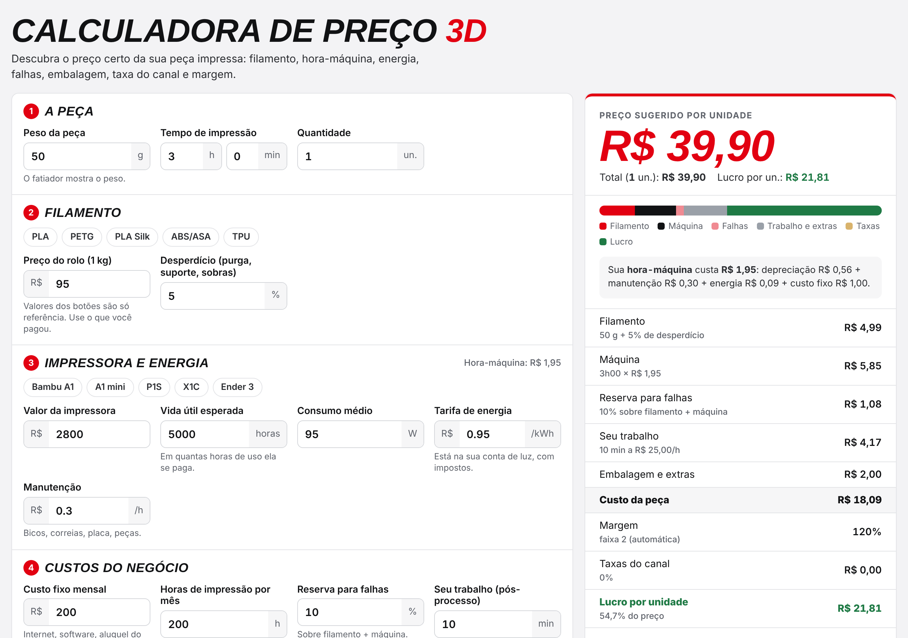

# Calculadora de preço 3D

Web app de uma página, hospedado na Vercel, que calcula o preço de venda de uma peça impressa em 3D e gera os documentos do pedido.



## Fórmula

Por unidade:

```text
hora-máquina  = valor da impressora ÷ vida útil      (depreciação)
              + manutenção por hora
              + consumo (W) ÷ 1000 × tarifa (R$/kWh)  (energia)
              + custo fixo mensal ÷ horas impressas/mês

filamento     = peso (g) × (1 + desperdício%) ÷ 1000 × preço do rolo (R$/kg)
máquina       = hora-máquina × tempo de impressão (h)
falhas        = (filamento + máquina) × reserva%
trabalho      = minutos ÷ 60 × valor da hora
custo         = filamento + máquina + falhas + trabalho + embalagem

margem        = automática por faixa de custo (peças baratas, margem maior) ou fixa
preço         = (custo × (1 + margem%) + tarifa fixa) ÷ (1 − taxa do canal%)
                opcional: arredondar para terminar em ,90
lucro         = preço − (preço × taxa% + tarifa fixa) − custo
```

A divisão por `(1 − taxa%)` garante que, depois de o marketplace descontar a comissão sobre o preço final, a margem desejada continue intacta.

## Documentos gerados

| Botão | Para quem | Conteúdo | Onde é gerado |
|---|---|---|---|
| PDF do cliente / WhatsApp | Cliente | Descrição, quantidade, valor unitário, total e validade (sem custos) | Navegador (jsPDF). No celular abre o compartilhamento nativo com o arquivo; no computador baixa o PDF e abre o WhatsApp com a mensagem pronta |
| Ficha do pedido (PDF interno) | Uso interno | Cliente, pedido, produção, composição do preço linha a linha, totais e checklist de produção | Servidor (`/api/enviar?preview=1`) |
| Copiar preço | — | Texto do preço | Navegador |

Exemplo da ficha com dados fictícios: [`examples/ficha-pedido-ficticia.pdf`](../examples/ficha-pedido-ficticia.pdf).

## Por que a ficha é gerada no servidor

A função `api/enviar.js` recebe apenas os **parâmetros** do cálculo e refaz a conta no servidor. Os números da ficha (a entrada do Workflow 1) não vêm da tela e não podem ser adulterados editando o JavaScript no navegador.

## Persistência

Os parâmetros de custo ficam no `localStorage` do navegador (chave `rg_calc3d_v1`). Os dados do cliente **não** são salvos.

## Integração direta com o n8n (desativada)

A função também tem um modo de envio direto a um webhook do n8n (`POST /api/enviar` sem `preview`), protegido por segredo em variável de ambiente (`N8N_WEBHOOK_URL`, `N8N_SECRET`). O botão que o acionava foi **removido da interface**, e o fluxo adotado é o upload da ficha no formulário do Workflow 1. O código foi mantido para uma eventual integração futura.
